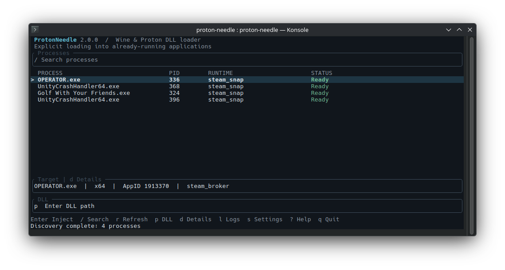

# ProtonNeedle

A Linux terminal UI for loading a trusted x64 Windows DLL into an **already-running Wine or Proton process**.

ProtonNeedle exists for situations where a Windows application is already running and you want to load a DLL without restarting it or changing Steam launch options. A Rust frontend discovers running sessions and a small C++ Windows helper performs verified `LoadLibraryW` loading in the selected Wine environment.



## Features

- Discover running Wine/Proton processes and inspect their Windows identities.
- Search processes, review runtime diagnostics, and select a target.
- Validate an x64 DLL before explicitly confirming a load.
- Reject unverified targets and block automatic retries after uncertain outcomes.
- Inspect processes without starting a Windows helper using `--passive` or `--list`.

## Build

Requires Linux, Rust **1.89+**, Cargo, CMake **3.20+**, an x86_64 MinGW-w64 C++ compiler, and nlohmann/json headers. On Ubuntu, install the C++ build dependencies with:

```sh
sudo apt install cmake g++-mingw-w64-x86-64 nlohmann-json3-dev
```

Then build the frontend and its Windows helper:

```sh
cargo build --release
./helper/build-helper.sh
./target/release/proton-needle
```

The build script installs the helper beside the Cargo binary in `target/release/helpers/`. Both components are required. Building Rust alone does not install the Windows helper.

## Use

Start the Windows application normally, then open ProtonNeedle. Select a discovered process, press `p` to enter the DLL path, and press `Enter` to validate it. Back in the process list, press `Enter` to review the target and `y` to confirm loading.

Other keys: `/` search, `r` refresh, `d` details, `l` diagnostics, `s` settings, `?` help, and `q` quit.

For read-only inspection:

```sh
./target/release/proton-needle --list
./target/release/proton-needle --passive
```

## Safety and compatibility

Only use DLLs you trust with applications you own or are authorized to modify. PE validation is not a malware scan. ProtonNeedle does not launch games, bypass anti-cheat, perform manual mapping, or support x86 DLL loading. **DO NOT TRY TO USE PROTONNEEDLE TO CHEAT OR EXPLOIT IN MULTIPLAYER GAMES. YOU WILL GET BANNED**

Targets and runtime access must be verified before loading. A timeout or uncertain result is **not** treated as a safe failure and is not automatically retried. The safeguards reduce risk but cannot make DLL injection harmless.

The isolated integration tests cover standard x64 Wine. Steam/Proton and sandboxed installations have additional runtime constraints and have **not** been comprehensively verified with live games.

## Tests

```sh
cargo fmt --all -- --check
cargo clippy --all-targets --all-features -- -D warnings
cargo test --all-targets --all-features
./helper/build-helper.sh --fixtures
```

The Wine integration tests are opt-in. They require Python 3, a native Wine loader and a private test prefix with self-built fixtures:

```sh
python3 tests/helper_integration.py --wine /absolute/path/to/native/wine --fixtures build/helper
python3 tests/helper_backend.py --wine /absolute/path/to/native/wine --fixtures build/helper
```

Steam/Proton is verified manually with a dedicated test target and probe DLL. See [tests/steam-proton/README.md](tests/steam-proton/README.md). `tests/steam_fixtures.py` checks those fixtures (PE checks, optional native Wine self-test) but does not involve Steam or Proton.

## License

MIT. See [LICENSE](LICENSE).
